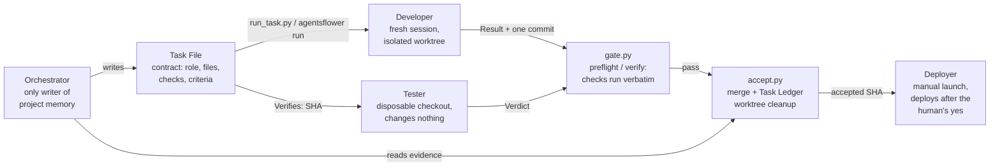
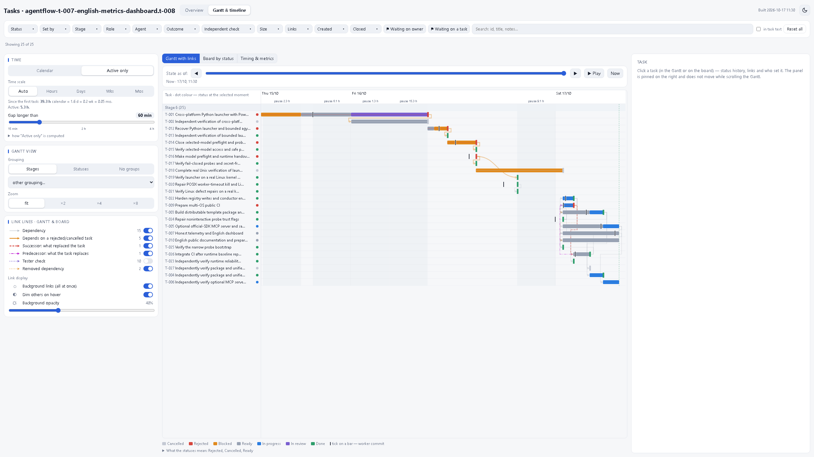

# AgentsFlower

[](https://github.com/agentsflower/agentsflower/actions/workflows/ci.yml)
[](LICENSE)
[](CHANGELOG.md)
[](pyproject.toml)
[](#mcp-server-optional)

Project memory and four agent roles for running one software project with several AI coding sessions (Claude Code, Codex CLI, Antigravity, Devin) without losing state or overwriting each other's work.

## Why

Multi-agent coding fails in predictable ways: context drifts between sessions, parallel workers collide on the same files, and "done" gets reported without evidence. AgentsFlower answers each failure with a small mechanism instead of a big framework:

- **Context drift** → one canonical project memory with a single writer. All rules live in one file, [.agentsflower/docs/ai-handoff-protocol.md](.agentsflower/docs/ai-handoff-protocol.md); everything else points there.
- **File collisions** → each task is one Task File, one branch, one isolated git worktree, one fresh session.
- **Hallucinated done** → acceptance runs the task's own `## Checks` verbatim through `gate.py`; only then does `accept.py` merge and update the Task Ledger.

Everything AgentsFlower puts into a project lives in one folder, `.agentsflower/`, so it never collides with the project's own `docs/`, `tasks/` or `tools/`. The project root gets only small entry points (`AGENTS.md`, `CLAUDE.md`, `.claude/commands/`) and a marked block in `.gitignore`; existing files keep their content. The core is Python 3.10+ stdlib only — no third-party runtime dependencies.

## How it works



The Orchestrator splits the goal into task contracts, launches workers and accepts results on evidence; it is the only writer of project memory. Developers and Testers each work on an isolated artifact (worktree / disposable checkout); the Deployer consumes only an accepted SHA and starts manually after human approval. Isolation is by git worktree plus post-attempt checks — not a universal sandbox guarantee for every tool.

## Studio Cockpit & Analytics Dashboard

```bash
agentsflower studio --open                       # launch local web cockpit (default: port 8888)
python .agentsflower/tools/studio.py --port 8888  # direct zero-dependency server
python .agentsflower/dashboard/build.py           # build static analytics -> .agentsflower/dashboard/out/
```

AgentsFlower Studio is a zero-dependency local web cockpit that unites project management, capacity routing, and codebase intelligence:

- **Multi-Project Cockpit**: sidebar switcher with automatic template discovery, smart flow-root resolution, and parent-path disambiguation (`Parent / code`).
- **Model Quota Hub**: dynamic live detection of installed agent CLIs (`devin`, `claude`, `codex`, `agy`, `ollama`), per-project platform & model activation toggles, and secure third-party provider integration (OpenRouter, Groq) with masked API keys.
- **Analytics & Roadmap**: 3-tab unified view containing **Tasks & Overview**, **Gantt & Dependency Graph**, and **Roadmap & Milestones** (`docs/project-plan.md` stage progression, task counts, and exit criteria).
- **Interactive Kanban & Inspector**: live task status filtering, visual task spec creator, and slide-out contract inspector.
- **Graft Code Intelligence**: AST codebase knowledge graph explorer and blast-radius impact analyzer.



*Screenshot: this repository's own development dashboard — real task data, captured locally.*

## Contents

| Path | What |
|---|---|
| `.agentsflower/docs/ai-handoff-protocol.md` | the protocol: terms, states, rules, session steps |
| `.agentsflower/roles/` | one instruction file per role; `tool-routing.md`: which tool takes which task |
| `.agentsflower/commands/` | slash-command texts (`.claude/commands/` holds one-line pointers) |
| `.agentsflower/tasks/_template.md` | Task File template |
| `.agentsflower/tools/` | `install.py` installer/updater, `run_task.py` launcher (`run-task.ps1` Windows wrapper), `cli.py` unified CLI, `studio.py` local web cockpit, `gate.py` preflight/verify/`done`, `accept.py` acceptance, `ledger.py` Task Ledger, `tick.py` scheduler, routing (`route.py`, `plan_route.py`, `route_report.py`, `quota_groups.py`), machine sharing (`machine_capacity.py`, `dispatch.py`), `hooks.py` Codex adapter, `mcp_server.py` optional MCP server |
| `.agentsflower/studio/` | AgentsFlower Studio web interface (HTML/CSS/JS, zero npm runtime dependencies) |
| `.agentsflower/dashboard/` | read-only analytics view for the human (`python .agentsflower/dashboard/build.py`) |
| `.agentsflower/tests/` | tests of the tools (`python -m unittest discover -s .agentsflower/tests`) |
| `.agentsflower/VERSION`, `.agentsflower/README.md` | version and folder map |
| `AGENTS.md`, `CLAUDE.md`, `.claude/commands/` | entry points for the tools |
| `GUIDE.md` | step-by-step guide: install, update, machine setup, daily use ([Russian version](GUIDE.ru.md)) |
| `CHANGELOG.md`, `RELEASE_NOTES.md` | what changed in each version; latest release notes |
| `.github/workflows/ci.yml` | CI matrix: ubuntu/macos/windows × Python 3.10–3.12, plus package and MCP integration jobs |

The template's own memory (`.agentsflower/state/`, `.agentsflower/docs/project-plan.md`) describes the development of AgentsFlower itself and is never copied into a project.

Requirements: git, Python 3.10+, and the CLIs of the tools you use. PowerShell is needed only on Windows, for the compatibility wrapper and the optional conductor (7 verified; 5.1 unverified). The conductor/autostart helpers are Windows-only.

## Quick start

```bash
python <AgentsFlower>/.agentsflower/tools/install.py <project> --dry-run   # see what would change
python <AgentsFlower>/.agentsflower/tools/install.py <project>             # install (later: --update)
```

Or build the local package for the `agentsflower` command (source install, not on PyPI):

```bash
python -m pip install build && python -m build
python -m pip install dist/agentsflower_sdlc-*.whl
agentsflower install <project>
```

Then follow [GUIDE.md](GUIDE.md). In Claude Code the Orchestrator starts with `/start-role orchestrator` and your goal; a session without a role uses `/start-session`.

## MCP server (optional)

Expose project state to Claude Code, Cursor or any MCP client over stdio:

```bash
python -m pip install "agentsflower-sdlc[mcp]"   # official SDK, opt-in extra
python .agentsflower/tools/install.py <project> --update --mcp
```

Read-only tools by default; `agentsflower_accept_task` only behind the explicit operator flag `--enable-orchestrator-tools`. The core tools never need the SDK.

## Verification status

Local evidence: Windows and Linux test-suite runs are recorded in [.agentsflower/docs/release-validation.md](.agentsflower/docs/release-validation.md). One remote CI run has executed (2026-10-17): the ubuntu test jobs and both package jobs were green; the windows-latest and macos-latest test jobs failed (the unit-test command exited 1) — an environment-specific failure still open — and the mcp jobs were skipped by dependency. There is still no green macOS result, and none is claimed here.

License: MIT.
